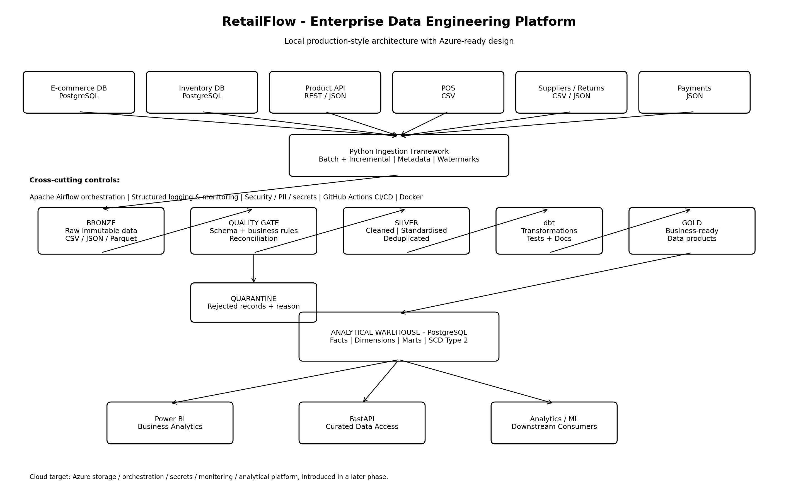

# RetailFlow
### End-to-End Retail Data Engineering Platform

RetailFlow is a multi-source retail data engineering platform designed to ingest, transform, validate and model operational data for analytics.

The project demonstrates practical data engineering using Python, PostgreSQL, Apache Airflow, dbt, Docker and dimensional modelling.

## Architecture


```text
Retail Source Systems
  |-- E-commerce
  |-- Point of Sale (POS)
  |-- Product API
  |-- Payments
  |-- Returns
  |-- Inventory
  |-- Suppliers
          |
          v
   Python Data Ingestion
          |
          v
   BRONZE DATA LAYER
   Raw Parquet + Run Metadata
          |
          v
   SILVER DATA LAYER
   Cleaning, Validation, Quarantine
          |
          v
   GOLD DATA WAREHOUSE
   Dimensions + Fact Tables
          |
          v
   dbt ANALYTICS
   Staging + Business Marts
          |
          v
   Analytics-Ready Datasets

Apache Airflow orchestrates the pipeline.
Docker Compose provides the local runtime.
```

## Technology Stack

| Technology | Purpose |
|---|---|
| Python | Ingestion and transformation |
| pandas / PyArrow | Data processing and Parquet |
| PostgreSQL | Source databases and warehouse |
| Apache Airflow 2.11 | Pipeline orchestration |
| dbt Core 1.9 | SQL analytics and data tests |
| Docker Compose | Containerised infrastructure |
| Git / GitHub | Version control |

## Data Engineering Pipeline

### Bronze — Raw Ingestion

The Bronze layer stores ingested source records as Parquet files with pipeline metadata.

Run metadata is used to identify successful ingestion runs.

### Silver — Standardisation and Quality

The Silver layer transforms source records into standardised PostgreSQL tables.

It includes validation, quarantine handling, reconciliation and transactional dataset replacement.

### Gold — Dimensional Warehouse

The Gold layer provides analytical dimensions and facts.

**Dimensions**
- Customer
- Product
- Date
- Store
- Supplier
- Channel

The product dimension supports Slowly Changing Dimension Type 2 (SCD2) history.

**Fact tables**
- E-commerce sales
- POS sales
- Payments
- Returns
- Inventory snapshots
- Inventory movements
- Supplier deliveries

## Apache Airflow Orchestration

The `retailflow_pipeline` DAG executes five sequential tasks:

1. `bronze_ingestion`
2. `silver_transformation`
3. `gold_dimensions`
4. `gold_facts`
5. `dbt_analytics_build`

The DAG uses Airflow's `LocalExecutor` and is currently triggered manually.

## Verified Pipeline Results

The latest validated full pipeline execution completed successfully.

| Metric | Result |
|---|---|
| Airflow tasks | 5/5 successful |
| dbt data tests | 42/42 passed |
| dbt models | 10 |
| Gold fact tables | 7 |
| Pipeline runtime | Approximately 1 minute 58 seconds |

These results describe the validated local execution, not a production service-level guarantee.

## Data Quality

RetailFlow includes automated checks for:

- Required values and uniqueness
- Referential integrity
- Accepted categorical values
- Sales arithmetic
- Revenue reconciliation
- Inventory consistency
- Supplier delivery accounting
- Supplier rate boundaries

## Running RetailFlow Locally

### Prerequisites

- Docker Desktop
- Python
- Git
- PowerShell (for the documented Windows commands)

Clone the repository:

```powershell
git clone https://github.com/Vino11190/RetailFlow.git
cd RetailFlow
```

Create local environment files from the provided example and configure the required credentials.

Do not commit real `.env` files.

Start the Airflow services from the `airflow` directory:

```powershell
cd airflow

docker compose --env-file ..\.env --env-file .env `
  -f docker-compose.airflow.yml `
  up -d --no-build airflow-webserver airflow-scheduler
```

The command assumes the required Docker images, databases and source services have already been prepared.

Access the Airflow UI at:

http://localhost:8080

Trigger the `retailflow_pipeline` DAG manually.

## Documentation

Additional technical documentation is available in:

- `docs/PHASE_10_AIRFLOW_ORCHESTRATION.md`
- `docs/architecture/`
- `docs/data_model/`

## Current Limitations

- Airflow scheduling is manual.
- The project is currently validated in a local Docker environment.
- Pipeline stages are transactionally isolated rather than atomic as one complete run.
- Historical facts currently resolve to the current product dimension version rather than an event-time SCD2 version.
- Additional monitoring, CI/CD, cloud deployment and performance testing are planned.

## Development Roadmap

- GitHub Actions CI/CD
- Automated testing and deployment checks
- Pipeline monitoring and alerting
- Cloud infrastructure
- Security and governance enhancements
- Performance and scalability testing
- Final technical documentation and portfolio presentation

## Project Status

**Core data engineering pipeline implemented and successfully validated locally.**

Further work focuses on production readiness, observability, deployment and automation.
