# RetailFlow — Gold Layer Star Schema

## Logical Entity Relationship Diagram

```mermaid
erDiagram
    DIM_CUSTOMER ||--o{ FACT_ECOMMERCE_SALES : customer_key
    DIM_PRODUCT ||--o{ FACT_ECOMMERCE_SALES : product_key
    DIM_DATE ||--o{ FACT_ECOMMERCE_SALES : date_key
    DIM_CHANNEL ||--o{ FACT_ECOMMERCE_SALES : channel_key

    DIM_PRODUCT ||--o{ FACT_POS_SALES : product_key
    DIM_STORE ||--o{ FACT_POS_SALES : store_key
    DIM_DATE ||--o{ FACT_POS_SALES : date_key
    DIM_CHANNEL ||--o{ FACT_POS_SALES : channel_key

    DIM_DATE ||--o{ FACT_PAYMENTS : date_key

    DIM_CUSTOMER ||--o{ FACT_RETURNS : customer_key
    DIM_PRODUCT ||--o{ FACT_RETURNS : product_key
    DIM_DATE ||--o{ FACT_RETURNS : date_key

    DIM_PRODUCT ||--o{ FACT_INVENTORY_SNAPSHOT : product_key
    DIM_STORE ||--o{ FACT_INVENTORY_SNAPSHOT : store_key
    DIM_DATE ||--o{ FACT_INVENTORY_SNAPSHOT : snapshot_date_key

    DIM_PRODUCT ||--o{ FACT_INVENTORY_MOVEMENTS : product_key
    DIM_STORE ||--o{ FACT_INVENTORY_MOVEMENTS : store_key
    DIM_DATE ||--o{ FACT_INVENTORY_MOVEMENTS : date_key

    DIM_SUPPLIER ||--o{ FACT_SUPPLIER_DELIVERIES : supplier_key
    DIM_PRODUCT ||--o{ FACT_SUPPLIER_DELIVERIES : product_key
    DIM_DATE ||--o{ FACT_SUPPLIER_DELIVERIES : expected_date_key
    DIM_DATE ||--o{ FACT_SUPPLIER_DELIVERIES : actual_date_key

    DIM_CUSTOMER {
        bigint customer_key PK
        string customer_id
        string city
        string postcode
        string country
    }

    DIM_PRODUCT {
        bigint product_key PK
        string product_id
        string sku
        string product_name
        string category_name
        string brand
        decimal unit_price
        boolean is_current
        timestamp effective_from
        timestamp effective_to
    }

    DIM_DATE {
        int date_key PK
        date full_date
        int year
        int quarter
        int month
        int day
    }

    DIM_STORE {
        bigint store_key PK
        string store_id
    }

    DIM_SUPPLIER {
        bigint supplier_key PK
        string supplier_id
        string supplier_name
        int lead_time_days
    }

    DIM_CHANNEL {
        bigint channel_key PK
        string channel_name
    }

    FACT_ECOMMERCE_SALES {
        bigint sales_key PK
        string order_item_id
        string order_id
        bigint customer_key FK
        bigint product_key FK
        int date_key FK
        bigint channel_key FK
        int quantity
        decimal line_total
    }

    FACT_POS_SALES {
        bigint pos_sales_key PK
        string transaction_id
        bigint product_key FK
        bigint store_key FK
        int date_key FK
        bigint channel_key FK
        int quantity
        decimal total_amount
    }

    FACT_PAYMENTS {
        bigint payment_key PK
        string payment_id
        string order_id
        int date_key FK
        decimal amount
    }

    FACT_RETURNS {
        bigint return_key PK
        string return_id
        string order_id
        bigint customer_key FK
        bigint product_key FK
        int date_key FK
        int quantity
        decimal refund_amount
    }

    FACT_INVENTORY_SNAPSHOT {
        bigint snapshot_key PK
        int snapshot_date_key FK
        bigint product_key FK
        bigint store_key FK
        int quantity_on_hand
        int reorder_level
    }

    FACT_INVENTORY_MOVEMENTS {
        bigint movement_key PK
        string movement_id
        bigint product_key FK
        bigint store_key FK
        int date_key FK
        int quantity
    }

    FACT_SUPPLIER_DELIVERIES {
        bigint delivery_key PK
        string delivery_id
        bigint supplier_key FK
        bigint product_key FK
        int expected_date_key FK
        int actual_date_key FK
        int quantity
    }
```



## Modelling Notes

1. Dimension primary keys are warehouse surrogate keys.
2. Source identifiers remain available for lineage and reconciliation.
3. Fact rows reference the dimension version valid at the event timestamp.
4. dim_product supports SCD Type 2 history.
5. dim_date is shared across business processes.
6. Date role-playing relationships are used for supplier delivery dates.
7. POS records do not contain customer identifiers.
8. Inventory snapshots represent captured stock positions, not reconstructed historical balances.
9. Unknown or missing dimensional relationships will use controlled unknown members where appropriate.
10. Fact uniqueness and business-key constraints will be defined in the physical DDL.
```
